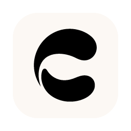

# Chord

**Stay in flow with local AI.**

AI shortcuts that work in any app on your Mac. 
Free, private, and running entirely on your device.

 

&nbsp;

[Website](https://chord-landing.vercel.app) ·
[Download](#download) ·
[Installation help](https://chord-landing.vercel.app/help) ·
[Release notes](https://github.com/MatthewLi-UW/chord-releases/releases)

 

## Skip the trip

Getting help from AI usually means a round trip: switch apps, paste in context,
wait, and come back. Chord cuts straight across. Press a shortcut in whatever
app you are working in, and the answer appears right there.

## Five tools, one shortcut each

| | Tool | Shortcut | What it does |
| :-: | --- | :-: | --- |
| 🔍 | **Lens** | <kbd>⌘</kbd> <kbd>⇧</kbd> <kbd>L</kbd> | Screenshots with markup and text copying built in. |
| 💬 | **Ask** | <kbd>⌘</kbd> <kbd>⇧</kbd> <kbd>A</kbd> | Ask about what's on your screen: selected text, clips, or images. |
| 📋 | **Clip** | <kbd>⌘</kbd> <kbd>⇧</kbd> <kbd>V</kbd> | Your clipboard history, searchable. Find anything you've copied and paste it again. |
| 📖 | **Define** | <kbd>⌘</kbd> <kbd>⇧</kbd> <kbd>D</kbd> | Select any word, phrase, or sentence for a quick explanation. |
| ✍️ | **Rewrite** | <kbd>⌘</kbd> <kbd>⇧</kbd> <kbd>R</kbd> | Tidy up your writing in the tone you want, with a preview before anything changes. |

Every shortcut is configurable in **Settings → Shortcuts**.

## Local by design

- **AI runs only on your Mac.** Nothing you capture or copy is uploaded.
- **Works offline** once the first-time setup has finished.
- **No account, no usage limits.** Download it and start working.
- **Free.**

## Download

| Mac | Download | |
| --- | --- | --- |
| **Apple silicon** (M1 and later) | [**Chord-arm64.dmg**](https://github.com/MatthewLi-UW/chord-releases/releases/latest/download/Chord-arm64.dmg) | Recommended |
| **Intel** | [Chord-x64.dmg](https://github.com/MatthewLi-UW/chord-releases/releases/latest/download/Chord-x64.dmg) | Experimental |

These links always point to the newest version. Earlier versions and release
notes are on the [releases page](https://github.com/MatthewLi-UW/chord-releases/releases).

### Install

1. Open the downloaded DMG and drag **Chord** into **Applications**.
2. Open Chord. It is signed and notarized by Apple, so macOS only asks you to
   confirm opening an app downloaded from the internet.
3. Follow the setup. Chord downloads its AI model once (about 2.5 GB, plus
   850 MB for optional vision support), so the first run needs an internet
   connection.
4. Grant the permissions for the tools you want: **Accessibility** for working
   with selected text and pasting, **Screen Recording** for Lens.

Requires **macOS 14 or later**. Stuck? See the
[installation guide](https://chord-landing.vercel.app/help).

### Updates

Chord updates itself from the releases in this repository, so once it is
installed there is nothing more to download by hand.

## Learn more

- 🌐 **Website:** [chord-landing.vercel.app](https://chord-landing.vercel.app)
- 🛟 **Installation help:** [chord-landing.vercel.app/help](https://chord-landing.vercel.app/help)
- 💼 **LinkedIn:** [Chord](https://www.linkedin.com/company/chordtools/) (follow for news, including Windows)

---

This repository hosts Chord's public downloads and update files. © 2026 Chord

